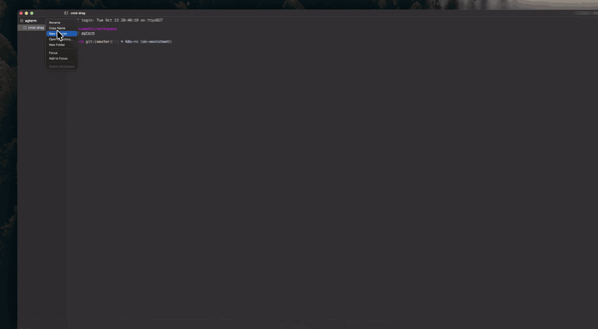

# agterm — fork with session folders

A personal fork of [umputun/agterm](https://github.com/umputun/agterm), a native macOS terminal with a
small interface and a full control API. The app, its documentation, command reference and cookbook are
the original project's.

This README covers only what the fork changes. Everything not listed here works exactly as upstream
describes it.

## Install

```sh
brew install --cask zhilins/apps/agterm
```

Or download the `.dmg` from [Releases](https://github.com/ZhilinS/agterm/releases) and drag `agterm.app`
into `/Applications`. Builds are for Apple Silicon Macs on macOS 14 or later, signed with a Developer ID
and notarized.

The fork and the original share the bundle id and the app name, so install one or the other, not both.
If you have upstream installed: `brew uninstall --cask agterm` first.

## What the fork adds



- **Session folders.** One level of folders inside a workspace: `workspace → folder → session`.
  Create one from a session or workspace menu, drag sessions in and out, **Move to** any folder of any
  workspace. A folder lives while it holds sessions: closing or moving out the last one removes it, and
  Reopen Closed Item or Open Recent bring the folder back with the session. ⌘N and the hover `+` add a
  session next to the active one, inside its folder when it has one.
  `agtermctl tree` shows `folder: <name>`.
  Upstream declined folders as a model change ([#293](https://github.com/umputun/agterm/discussions/293),
  [#397](https://github.com/umputun/agterm/pull/397),
  [#406](https://github.com/umputun/agterm/discussions/406)), hence a fork and not a PR.
- **Rename on double-click.** Upstream renames a workspace on a second click, so every click on a row
  waits out the double-click delay before it toggles. This setting (General ▸ Mouse) moves rename to
  double-click and the row responds to a single click at once.
- **⌘-drag the quick terminal.** Drag the panel anywhere; the position is remembered per display until
  the next launch.
- **Share an HTML page to GitLab Pages.** With a GitLab URL, project and token in Settings ▸ Sharing, a
  file page's strip gets Share: it copies a stable link and publishes the page; `agtermctl session overlay
  share` does the same from a script.

Known differences: `workspaces.json` has a fork-only format, so switching builds starts with an empty
tree. Dragging folder rows themselves is not done yet.

## Keeping up with upstream

Fork `master` carries the features on top of upstream `master`:

```sh
git fetch upstream && git merge upstream/master
```

Releases are cut from the fork and follow upstream's version numbers with a patch bump.

## Issues

Problems with folders, the rename setting or ⌘-drag go to this fork's
[Issues](https://github.com/ZhilinS/agterm/issues). Anything else is upstream behavior; please check it
against the original build before reporting it upstream.

## License

MIT, same as upstream. Copyright remains with Umputun; see [LICENSE](LICENSE). agterm embeds [libghostty](https://github.com/ghostty-org/ghostty) (MIT) for
rendering, VT parsing and shell I/O; the original README carries the full attribution.
